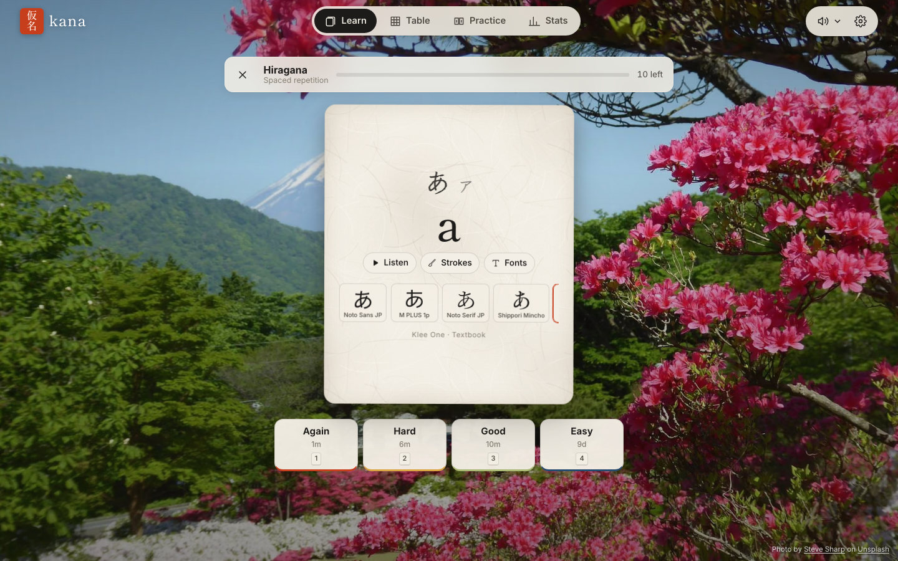
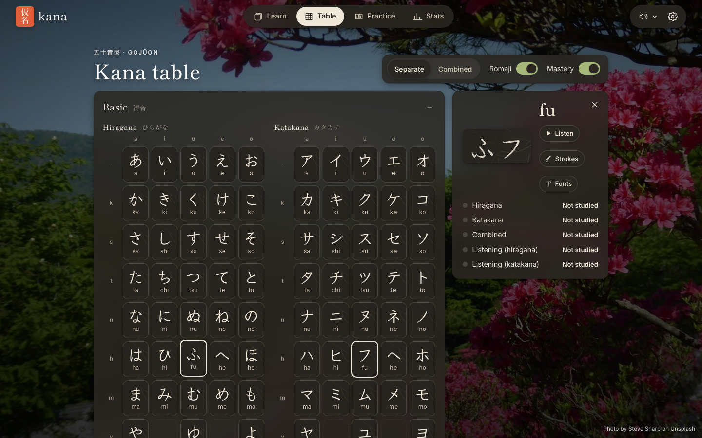

# kana

**Learn to read hiragana and katakana in your browser** — with spaced repetition, real pronunciation,
stroke-order animations and flashcards that look like ink on washi paper.

**→ https://jeroenjanssens.github.io/kana/**





## Features

- **Spaced repetition** (FSRS, the algorithm Anki uses) for three decks: hiragana, katakana, and
  both side by side. Self-grade like Anki, or type the romaji and get a suggested grade. **Undo**
  any answer, and optionally **personalise the intervals** to your own memory with the FSRS
  optimizer.
- **An introduction for every new kana**: its sound, an animated stroke order and a memory
  hint, before it's quizzed. The hints and drawings come from Tofugu's
  [Learn Hiragana](https://www.tofugu.com/japanese/learn-hiragana-book/) and
  [Learn Katakana](https://www.tofugu.com/japanese/learn-katakana-book/) books, with the drawing
  shown over the kana after the answer (or always, or never).
- **Writing practice**: see the romaji and draw the kana; stroke count, order and direction are
  checked stroke by stroke. Or choose the right kana from look-alikes.
- **In-order mode** to go through rows one by one without touching your schedule.
- **Kana table** with separate or combined layouts, a romaji toggle, click-to-hear, memory hints
  and a mastery overlay that shows how well you know each kana.
- **Pronunciation** for every kana and every reading word, in a female or male voice (or a random
  one per card), generated with VOICEVOX.
- **Fonts**: pick one of 15 Japanese fonts, or let every card use a random one, plus a font gallery.
- **Practice modes**: confusable pairs (シ/ツ, ぬ/め, …, also built from your own mistakes),
  listening with its own schedule, reading practice with ~400 real words, a **sprint** of one to
  five minutes, and a **race** through a set of kana you choose.
- **Help with tricky kana**: cards you keep forgetting are flagged, with a hint and a drill.
- **Stats**: activity heatmap, streaks, a **daily goal**, due forecast, mastery per deck, weakest,
  tricky and most-confused kana. A daily reminder can be added to your calendar.
- **Look & feel**: washi-paper cards with ink (every card on its own sheet), photos of Japan that
  match the season, hanko seals for mastered cards, real koto notes whose pitch follows your
  answer, light and dark themes, and a light vibration on phones.
- **In English and Dutch** (Nederlands).
- **Works offline** and can be installed as an app. Progress stays in your browser; export it,
  or sync it between devices through a secret GitHub gist.

## Development

You need Node.js 22+ and [just](https://github.com/casey/just).

```sh
just install   # install dependencies
just dev       # start the dev server at http://localhost:5173/kana/
just test      # unit tests (Vitest)
just e2e       # end-to-end tests (Playwright)
just ci        # lint, type-check, unit tests, build and e2e — what CI runs
```

Run `just` to see all tasks. The asset pipelines (`just audio` with `just voicevox`, `just fonts`,
`just kanjivg`, `just tofugu`, `just photos`, `just sfx`, `just icons`) regenerate the files in
`public/`, `src/lib/data/kanjivg/` and `src/lib/data/tofugu/` from their sources; their output
is committed, so you only need them when changing assets. `just tofugu` needs poppler and potrace
(`brew install poppler potrace`).

### Project layout

```
src/
  lib/        plain TypeScript: kana data, SRS, storage, audio engine, stats (unit-tested)
  state/      reactive Svelte state (*.svelte.ts)
  components/ reusable UI (paper card, stroke order, font gallery, charts, …)
  views/      one component per page
scripts/      asset pipelines (audio, fonts, photos, sound effects, stroke data, icons)
tests/        unit/ (Vitest) and e2e/ (Playwright)
```

Pushing to `main` runs the full test suite and deploys to GitHub Pages.

See [PLAN.md](PLAN.md) for the design and decisions.

## Credits

kana builds on the generous work of others — see [NOTICE](NOTICE) and the in-app credits page:
memory hints and drawings from Tofugu's Learn Hiragana and Learn Katakana books, pronunciation
generated with VOICEVOX (VOICEVOX:春日部つむぎ, VOICEVOX:青山龍星), stroke data from
KanjiVG (CC BY-SA 3.0), fonts from Google Fonts (OFL), photos from Unsplash, and sound effects
from Freesound (CC0) and a koto recording by Torsodog (Wikimedia Commons, CC BY 3.0).

## License

The code is MIT licensed. Bundled assets keep their own licences, listed in [NOTICE](NOTICE).
